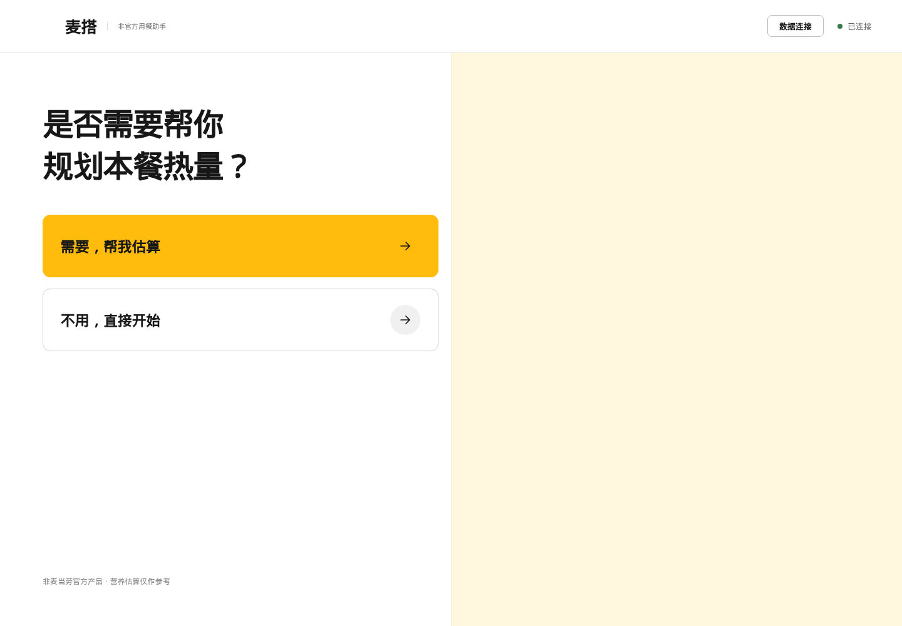
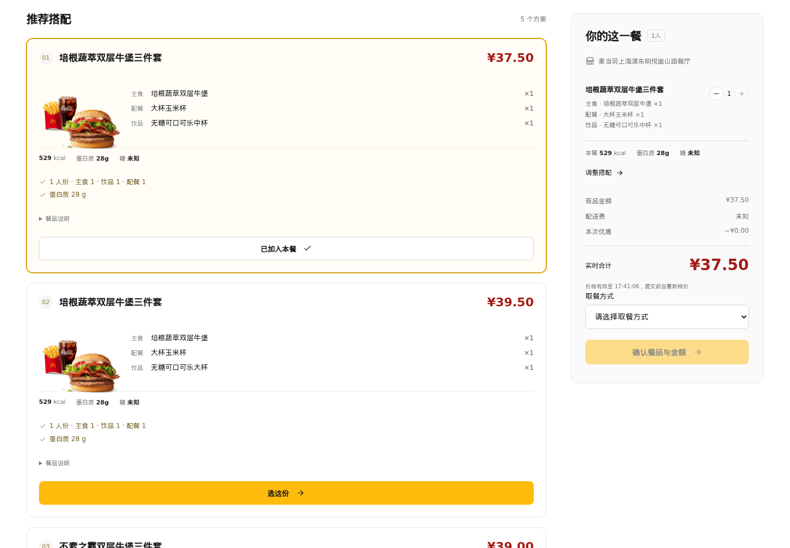
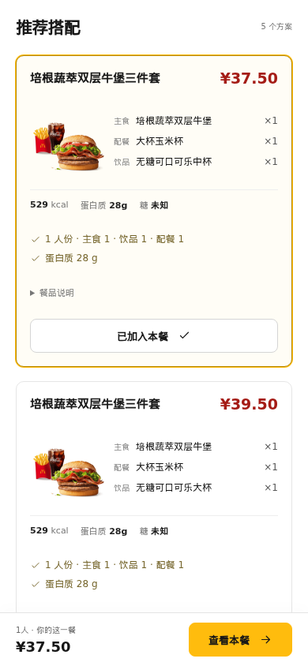
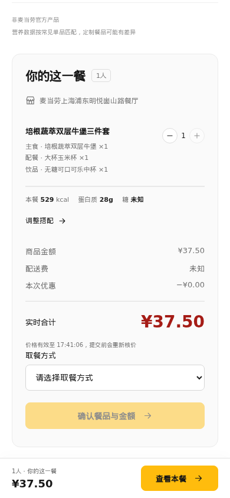

<div align="center">

# 麦搭

### 把想吃的，搭成这一餐。

预算、口味、人数，一句话说清。剩下的交给麦搭。

**[立即体验](https://mai-da.richard950825.workers.dev)** · **[获取麦当劳 MCP Token](https://open.mcd.cn/mcp)** · **[自己运行](#自己运行)**

</div>



> **“不超过 60 元，牛肉，无糖可乐，套餐优先。”**
>
> 这就是一次点餐的开始。不必先弄懂菜单分类，也不用把想吃的翻译成一长串筛选条件。

麦搭会读取你选中的餐厅菜单，组合主食、配餐和饮品，再查询实际价格。喜欢哪份就选哪份；想换口味、改预算、加个人，接着说就好。

## 少纠结一会儿，多享受这一餐

| 你想要的 | 麦搭帮你做的 |
| --- | --- |
| **有预算，也想吃得合心意** | 按实时核价筛选，金额和餐品明细放在一起看 |
| **想吃牛肉，饮料要无糖** | 同时考虑口味和饮品选择，保留套餐里的具体规格 |
| **一个人吃，或和朋友一起** | 支持 1–6 人搭配，主食和饮品按人数安排 |
| **想看看这餐的热量** | 可选的热量估算与手动目标；也可以直接跳过 |
| **选好了，再决定要不要下单** | 先看明细、价格和取餐方式，确认后才创建订单 |

## 真正看得见的一餐

**电脑上，方案和本餐明细并排。** 一眼比较不同搭配，也能看到选中的餐品与实时合计。



**手机上，边选边看。** 一只手也能浏览推荐，底部随时打开“查看本餐”。

<table>
  <tr>
    <td align="center"><br /><b>选一份喜欢的搭配</b></td>
    <td align="center"><br /><b>金额、餐品、取餐方式，一起核对</b></td>
  </tr>
</table>

以上为 **2026 年 10 月 10 日实际网页截图**，使用真实麦当劳菜单、实时核价和 AI 规划，没有填入演示餐品或虚构价格。截图中的价格只代表当次查询，实际供应与价格以所选餐厅为准。

## 三步，把这一餐安排好

1. **连接自己的麦当劳账户。** 到官方 MCP 页面登录并复制 Token，回到麦搭粘贴即可。无需填写 AI 密钥。
2. **选餐厅，说需求。** 例如“预算 40 元，想吃鸡肉”，或者“两个人，牛肉套餐优先”。不想估算热量？直接开始。
3. **选搭配，再核对。** 调整餐品数量、选择取餐方式，确认明细和条款后创建订单，再前往麦当劳官方页面支付。

如果换了主意，也不用重头来过：

> “不要咖啡，换成无糖可乐。”<br />
> “改成两个人吃。”<br />
> “预算提高到 80 元，套餐优先。”

## 热量可以参考，吃什么由你决定

麦搭不会强迫你先填一张身体信息表。需要时再估算，也可以直接输入已有目标。

年龄、身高、体重只在当前浏览器页面计算，不会上传。没有核实的营养值会显示为“未知”，不会为了凑出一个漂亮数字而补零。

## 适合谁

- 午休时间有限，想尽快选好一餐的人。
- 有预算或口味偏好，不想反复翻菜单的人。
- 和朋友一起点餐，希望按人数安排搭配的人。
- 想参考营养信息，但希望自己做决定的人。

## 放心用自己的账户

- 每位访客连接自己的 MCP Token，账户与订单明细相互隔离。
- Token 只保留在服务端会话中，30 分钟未操作后需要重新连接。
- AI 由本站提供；密钥不会发到浏览器，也不在本仓库中。
- 公网体验每个 IP 每天可使用 **10 次 AI 操作**，北京时间零点重置。一次规划计一次，AI 菜单处理和连接检查共用额度；开始处理后失败或重试也计次。
- 创建订单前需要你明确确认，支付在麦当劳官方页面完成。

麦搭是独立开发的非官方用餐助手。营养估算仅供参考，不构成医疗或饮食处方；有食物过敏时，请核对官方信息并联系餐厅。

## 自己运行

<details>
<summary><b>想把麦搭跑在自己的电脑上？展开这几步</b></summary>

准备 Node.js 22.13 或以上版本（需支持 `node:sqlite`）和 npm。

```sh
git clone https://github.com/richard950825-sys/mai-da.git
cd mai-da
npm ci
cp .env.example .env.local
```

在 **本机的 `.env.local`** 中填写自己的 `DEEPSEEK_API_KEY`，保留 `PUBLIC_ACCESS=true`。无需在文件里填写麦当劳 Token，它会在打开页面时由使用者输入。

```sh
npm run build
npm start
```

打开 `http://127.0.0.1:8798/`，开始搭配。默认关闭真实下单，开启方法见 [运行与部署说明](docs/DEVELOPMENT.md)。

</details>

本仓库包含完整的 **前端、后端、Cloudflare 网关、测试、构建配置和公开素材**。克隆后可以自行构建运行；没有只放网页打包文件。私密配置、真实账户数据、运行日志和历史交接包不属于公开源码。

想继续改造？查看 [运行与部署说明](docs/DEVELOPMENT.md)、[MCP 接入说明](MCP_INTEGRATION.md) 和 [营养估算方法](docs/calorie-method.md)。

## 关于这个作品

麦搭基于麦当劳中国 MCP 能力开发，按 [麦当劳程序员创意开发大赛官方要求](https://github.com/M-China/mcd-developer-innovation-challenge) 整理开源材料。

- [参赛声明](CONTEST_DECLARATION.md)：采用官方原文。
- [MCP 配置示例](mcp-config.example.json)：仅含环境变量占位符。
- 本项目未使用 WorkBuddy，不申请 WorkBuddy 专项奖励。
- 项目代码采用 [MIT License](LICENSE)。第三方商标、餐品图片与依赖保留各自权利，见 [素材与第三方说明](THIRD_PARTY_NOTICES.md)。

---

<div align="center">

**今天想怎么吃？交给麦搭试试看。**

[打开麦搭](https://mai-da.richard950825.workers.dev) · 如果它帮你少纠结了一餐，欢迎给项目点一颗 Star。

</div>
